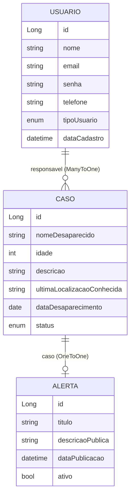

# Find Me — API REST (Java Advanced)

API REST em **Java 21 + Spring Boot 4.1.2** que sustenta a solução **Find Me** (CitizenTech, Global Solution 2026/2):
divulgação responsável de casos de desaparecimento de crianças e adolescentes, com validação interna antes da publicação.

## Integrantes

| Nome                | RM     | Turma  |
|---------------------|--------|--------|
| Caio Couto          | 563452 | 2TDSPS |
| Guilherme Eustáquio | 566784 | 2TDSPS |
| Matheus Tavares     | 566844 | 2TDSPS |

- **Vídeo Pitch:** (preencher)
- **Repositório:** https://github.com/caioccouto/FindMe-GlobalSolution.git

## Como executar

Pré-requisito: JDK 21. Banco H2 em arquivo (`./data/findme`), criado automaticamente.

```bash
./mvnw spring-boot:run
```

- API: `http://localhost:8080`
- Swagger UI: `http://localhost:8080/swagger-ui/index.html`
- OpenAPI JSON: `http://localhost:8080/v3/api-docs`
- Console H2: `http://localhost:8080/h2-console` (JDBC `jdbc:h2:file:./data/findme`, usuário `sa`, sem senha)
- Actuator: `/actuator/health`, `/actuator/info` (públicos) e `/actuator/metrics` (somente MODERADOR)

Variáveis de ambiente opcionais: `JWT_SECRET` (Base64, ≥ 32 bytes), `SEED_*` (ver `application.yaml`).

## Usuários de teste (criados na primeira execução)

| Papel | E-mail | Senha |
|-------|--------|-------|
| MODERADOR | moderador@findme.com | Moderador@123 |
| RESPONSAVEL | responsavel@findme.com | Responsavel@123 |
| COLABORADOR | colaborador@findme.com | Colaborador@123 |

## Autenticação (fluxo JWT)

1. `POST /api/auth/register` — cadastra (`tipoUsuario` = `RESPONSAVEL` ou `COLABORADOR`; MODERADOR nunca é auto-atribuído). Senha gravada com BCrypt.
2. `POST /api/auth/login` — devolve `token` (HS256, 1 h, claims `sub`=e-mail e `tipoUsuario`).
3. Enviar `Authorization: Bearer <token>` nas demais chamadas. No Swagger, use o botão **Authorize**.
4. `GET /api/auth/me` — dados do dono do token.

Erros: 401 (sem/ inválido token), 403 (papel sem permissão ou caso de outro responsável), todos no formato JSON padronizado.

## Modelo de entidades



- `Caso.responsavel`: **ManyToOne** (um usuário tem vários casos).
- `Alerta.caso`: **OneToOne** com `unique` — um caso gera no máximo um alerta público (a versão autorizada dele).
- Ciclo do caso: `EM_ANALISE → VALIDADO → PUBLICADO → EM_ACOMPANHAMENTO → LOCALIZADO → ENCERRADO` (transições validadas na entidade; inválidas retornam 409).

## Permissões por papel

| Recurso | RESPONSAVEL | COLABORADOR | MODERADOR |
|---------|:-----------:|:-----------:|:---------:|
| Registrar caso (`POST /api/casos`) | ✔ | ✖ | ✖ |
| Ver/listar casos | só os próprios | ✖ | todos |
| Editar caso | próprio, enquanto `EM_ANALISE` | ✖ | qualquer |
| Alterar status / excluir caso | ✖ | ✖ | ✔ |
| Listar/ver alertas públicos ativos | ✔ | ✔ | ✔ |
| Criar/editar/retirar alerta, ver inativos | ✖ | ✖ | ✔ |
| `/api/usuarios/**`, `/actuator/metrics` | ✖ | ✖ | ✔ |

## Endpoints principais

| Método | Rota | Descrição |
|--------|------|-----------|
| POST | `/api/auth/register` · `/api/auth/login` | Cadastro e login (públicos) |
| GET | `/api/auth/me` | Usuário autenticado |
| GET/PUT | `/api/usuarios`, `/api/usuarios/{id}`, `/api/usuarios/{id}/tipo` | Administração (MODERADOR) |
| GET | `/api/casos` | Lista com filtros (`status`, `nome`, `idadeMin`, `idadeMax`, `dataInicio`, `dataFim`), `page`, `sizePage`, `sortBy`, `direction` |
| GET | `/api/casos/meus` · `/api/casos/estatisticas` · `/api/casos/{id}` | Meus casos · total por status · detalhe |
| POST/PUT/DELETE | `/api/casos` · `/api/casos/{id}` | CRUD (201 / 200 / 204) |
| PATCH | `/api/casos/{id}/status` | Transição de status (MODERADOR) |
| GET | `/api/alertas` · `/api/alertas/recentes?dias=7` · `/api/alertas/{id}` | Consulta pública (autenticada) |
| GET | `/api/alertas/admin?ativo=` | Todos os alertas (MODERADOR) |
| POST/PUT/DELETE | `/api/alertas` · `/api/alertas/{id}` | Publicar / editar / retirar (MODERADOR) |

Exemplo rápido:

```bash
TOKEN=$(curl -s -X POST localhost:8080/api/auth/login -H 'Content-Type: application/json' \
  -d '{"email":"responsavel@findme.com","senha":"Responsavel@123"}' | sed 's/.*"token":"\([^"]*\)".*/\1/')

curl -X POST localhost:8080/api/casos -H "Authorization: Bearer $TOKEN" -H 'Content-Type: application/json' \
  -d '{"nomeDesaparecido":"Maria Silva","idade":12,"descricao":"Cabelo castanho, camiseta azul","ultimaLocalizacaoConhecida":"Praça central","dataDesaparecimento":"2026-11-10"}'
```

Fluxo completo de demonstração: responsável cria caso → moderador `PATCH /api/casos/{id}/status {"status":"VALIDADO"}` → moderador `POST /api/alertas {casoId,titulo,descricaoPublica}` → colaborador `GET /api/alertas` → moderador marca `LOCALIZADO` (alerta fica `ativo=false` e some da consulta pública).

## Consultas e cache — justificativas

- **Query method derivado:** `CasoRepository.findByResponsavelId` (tela "acompanhar meus casos"), `AlertaRepository.findByCasoId` / `existsByCasoId` (garantir 1 alerta por caso).
- **`@Query` JPQL:** `CasoRepository.contarPorStatus` (agregação para o painel do moderador) e `AlertaRepository.buscarAtivosPublicadosDesde` (feed "alertas recentes").
- **Filtros dinâmicos (`Specification`):** `CasoSpecifications` e `AlertaSpecifications` — todos os filtros são opcionais e combináveis, evitando uma explosão de métodos derivados.
- **`@Cacheable`:** `alertas-publicos`, `alerta-publico`, `alertas-recentes` (lidos por toda a comunidade, mudam pouco) e `casos-estatisticas`. Consultas por usuário (casos) **não** são cacheadas, pois o resultado depende de quem consulta.
- **`@CacheEvict`:** toda escrita em alertas e toda mudança de status/exclusão de caso invalida os caches afetados (`allEntries = true`).
- Cache em memória (`ConcurrentMapCacheManager` do Spring Boot).

## HATEOAS

Respostas de caso e alerta são `EntityModel` com `self`, recursos relacionados (`casos`, `meus-casos`, `alerta`, `caso`, `alertas-recentes`) e **ações possíveis conforme papel e status** (`atualizar`, `alterar-status`, `excluir`, `publicar-alerta`, `retirar`). Listas retornam `mapper.br.com.globalsolution.findme.PageResponse` (mesmo padrão do projeto de referência) com cada item já contendo seus links.

## Privacidade

- O alerta público expõe apenas: título, descrição pública, data de publicação, nome, idade e data do desaparecimento. **Não** expõe responsável, telefone, descrição privada nem a última localização conhecida (o moderador decide o que entra na `descricaoPublica`).
- Casos só são visíveis ao responsável dono e ao moderador; caso não publicado nunca aparece em `/api/alertas`.

## Decisões técnicas

- Mesma arquitetura do `project-mgt-main` (controller / service + impl / repository / dto / mapper / assembler / security / configurations / exceptions), `Usuario` implementa `UserDetails`, `SecurityConfig`, `JwtService` e `GlobalExceptionHandler` adaptados.
- Adições exigidas pelo item 6.5 e ausentes no projeto de referência: Spring Cache, Actuator, `Specification` e JPQL. A API não é consumida por app Mobile neste escopo, por isso não há configuração de CORS (o Swagger UI usa a mesma origem).
- O histórico de status (RN07) é registrado em **log de auditoria** (`AUDITORIA caso=… status A -> B por e-mail`), pois só três entidades são permitidas.
- Publicar = criar o alerta (caso `VALIDADO` → `PUBLICADO`); retirar o alerta devolve o caso a `VALIDADO`; `LOCALIZADO`/`ENCERRADO` desativam o alerta automaticamente (RN06).
- Idade limitada a 0–17 anos (foco em crianças e adolescentes).
- Alertas exigem login (qualquer papel). Para torná-los totalmente públicos, libere `GET /api/alertas/**` no `SecurityConfig`.
- O banco é H2 em arquivo (igual ao projeto de referência); basta trocar `spring.datasource.*` para outro SGBD.

## Declaração de uso de IA

Ferramenta: Claude (Anthropic). Finalidade: Evitar repetição de código iguais para diferentes entidades.

## Prompt Utilizado

Use o código da entidade existente como referência e replique sua implementação para a nova entidade. Por exemplo, pegue o Controller de uma entidade Model e crie um Controller equivalente para outra entidade Model, mantendo a mesma estrutura, organização, lógica e padrão de código, mas adaptando os atributos, métodos e regras de negócio para a nova entidade.

Faça o mesmo para Services, Repositories, DTOs e demais classes relacionadas. Não copie apenas os nomes: adapte o código conforme as características da nova entidade.

Mantenha o padrão já utilizado no projeto e implemente diretamente nos arquivos.